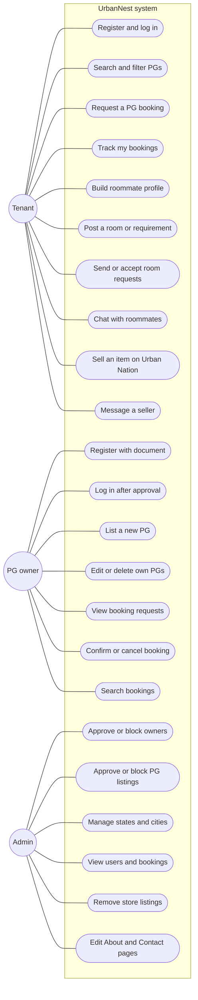
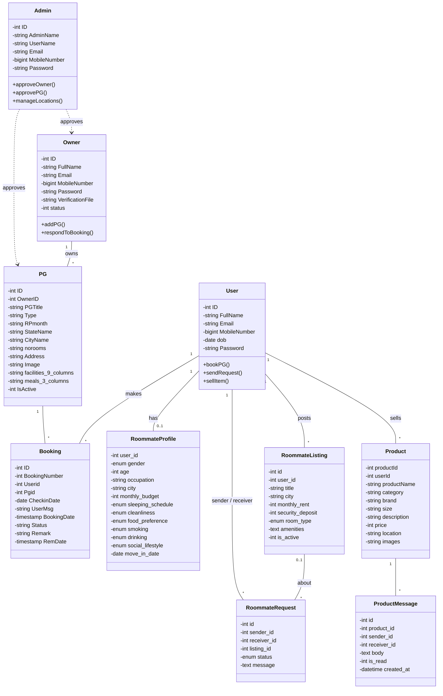
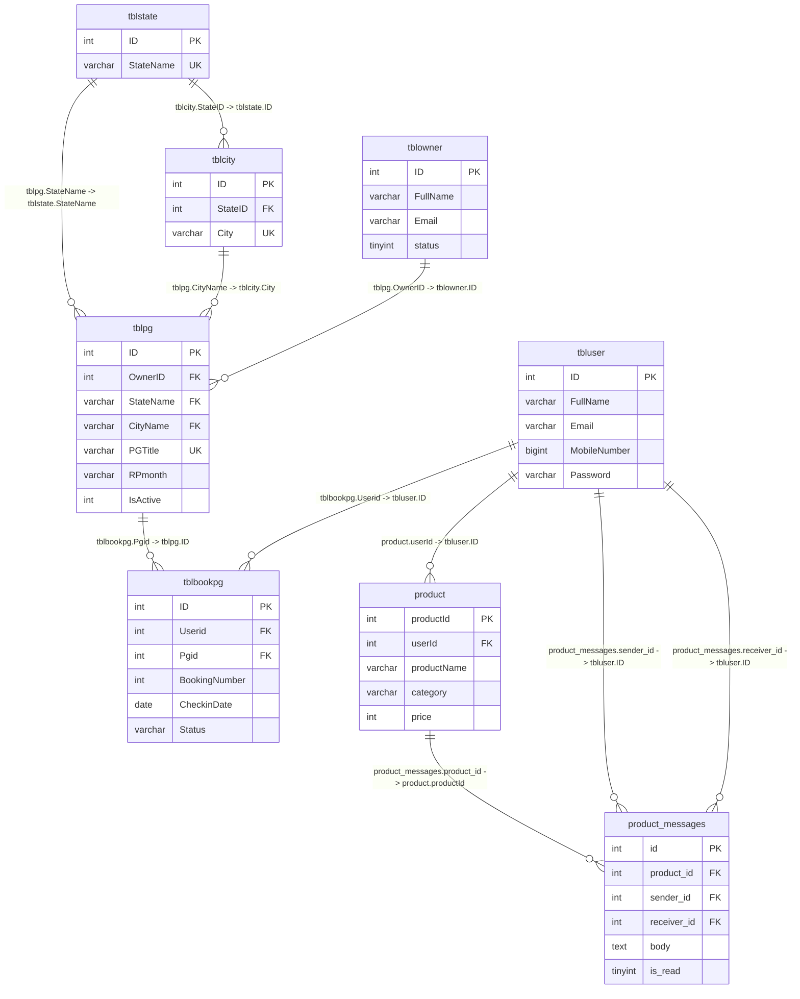
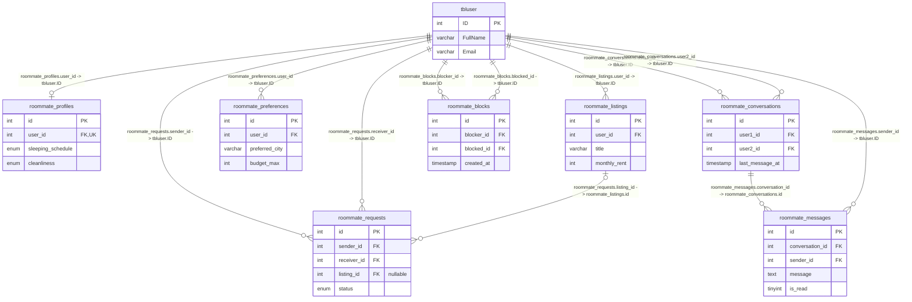
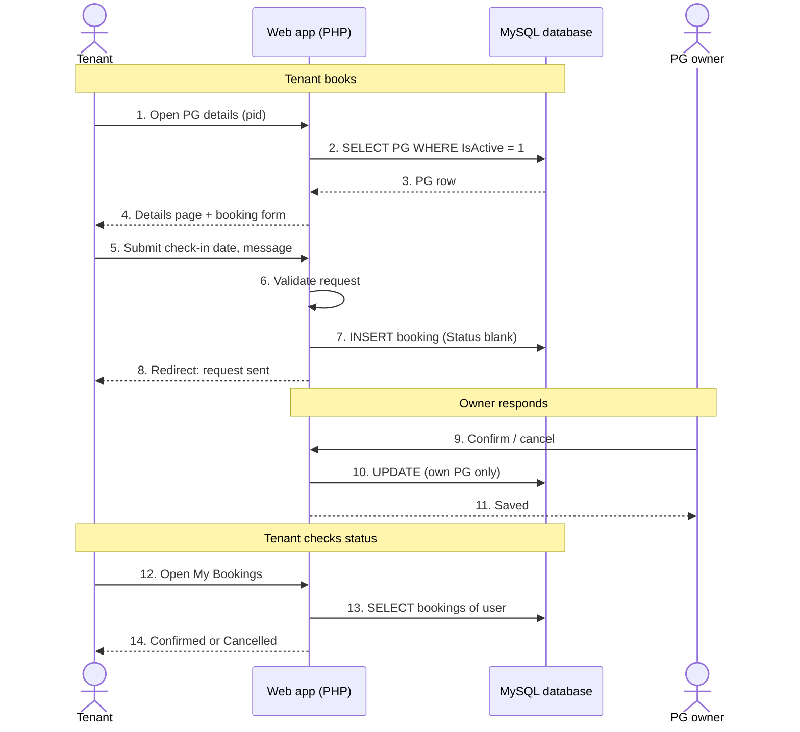
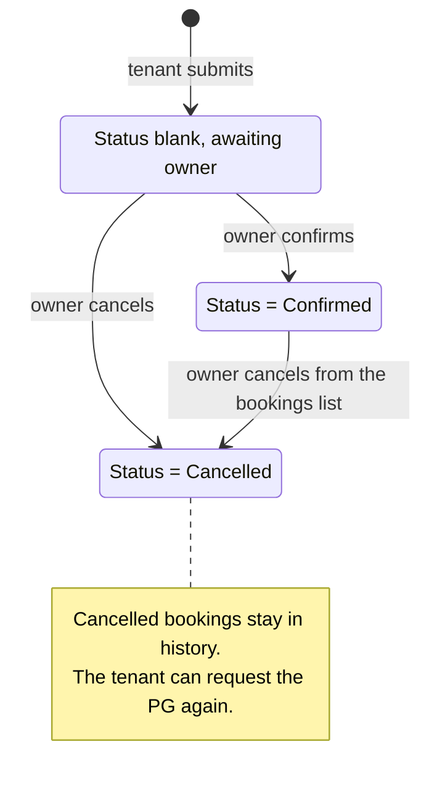
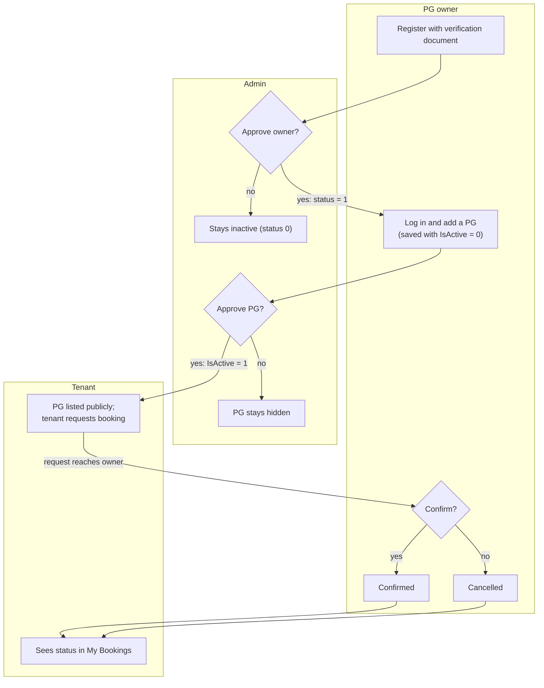
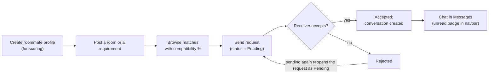
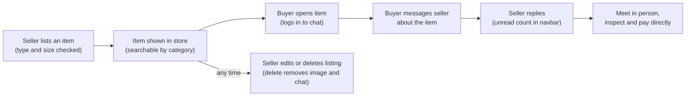
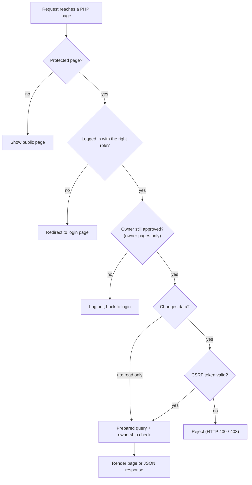

# UrbanNest — Enterprise Computing Project Writeup

## 1. Title of the Project

**UrbanNest: An Integrated Web Platform for PG Accommodation, Roommate Matching and Resident Thrift Trading**

| Item | Details |
| --- | --- |
| Project name | UrbanNest |
| Domain | Web-based enterprise application (real estate / student housing) |
| Modules | PG Accommodation, Roommate Matching, Urban Nation (thrift marketplace), Owner Portal, Admin Portal |
| Technology | PHP 8, MySQL / MariaDB, HTML5, CSS3, Bootstrap 5, JavaScript |
| Users | Tenants / students, PG owners, administrators |
| Submitted by | _Student names and roll numbers_ |
| Guide | _Guide name_ |
| Institution | _College / department_ |

## 2. Introduction

UrbanNest is a web platform that lets students and working professionals find a PG, find a compatible roommate and buy or sell second-hand essentials in one place. It connects three groups: tenants who need housing, PG owners who list rooms, and an administrator who verifies owners and listings.

**Problem.** People moving to a new city usually search PGs through brokers, scattered classifieds and word of mouth. They meet roommates by chance, and furniture or appliances are bought new and abandoned when they move out. Owners, meanwhile, have no simple channel to reach verified tenants.

**Objectives**

1. Give tenants one searchable list of admin-approved PGs, filterable by state, type and budget, with online booking requests.
2. Match roommates by lifestyle using a compatibility score based on sleep schedule, cleanliness, food habits, smoking, drinking and similar factors.
3. Provide a zero-commission thrift marketplace (Urban Nation) with built-in buyer–seller chat.
4. Give owners a portal to list PGs and confirm or cancel booking requests.
5. Give administrators control over locations, owner approval, PG approval, users and site content.
6. Keep user data safe through hashed passwords, access control, input validation and protection against common web attacks.

## 3. Project Description

UrbanNest has five modules used by three roles. Tenants use the public site, roommate module and Urban Nation; owners use the Owner Portal; the administrator uses the Admin Portal. All modules share one MySQL database, one login session per role and one navigation bar on the public side.

### 3.1 Tenant / user module

- **Registration and login.** Users register with name, email, 10-digit mobile number and password. Duplicate email or mobile numbers are rejected. Passwords are stored with PHP `password_hash()`.
- **Profile.** Users update their name, mobile number and date of birth, and change their password after confirming the current one.
- **Forgot password.** Users verify their email and registered mobile number, then set a new password (limited to 5 attempts per session).
- **Home page.** A hero carousel, a quick PG search (state, PG type, maximum rent), service cards for the three modules and the latest approved PG listings.

### 3.2 PG accommodation and booking

- **Find a PG.** Lists only admin-approved PGs, with filters for keyword (name, city, area), state, PG type (Boys, Girls, Both) and maximum monthly rent.
- **PG details.** Shows the photo, rent, number of rooms, address, facilities (electricity, parking, refrigerator, furnishing, AC, balcony, study table, laundry, security) and meals offered.
- **Booking request.** A logged-in user picks a check-in date (today to 3 months ahead) and writes a message to the owner. A user cannot hold two active requests for the same PG; a cancelled request does not block a new one.
- **My Bookings.** Lists each request with booking number, PG, dates and status (Awaiting owner, Confirmed, Cancelled), plus a details page showing the owner's remark.

### 3.3 Roommate matching

- **Roommate profile.** Users record lifestyle details: gender, age, occupation, sleep schedule, cleanliness, food preference, smoking, drinking, social style, move-in date and a profile photo.
- **I Have a Room.** Post a room listing with title, city, locality, rent, deposit, availability date, accommodation and room type, furnishing, amenities, roommate preferences and up to 5 photos.
- **I Need a Room.** Post a requirement with preferred city, budget range, room type and move-in date.
- **Browse and filter.** Switch between room listings and room seekers, filtering by city, type, gender preference, budget and room type.
- **Compatibility score.** Each match is scored 0–100 from eight weighted factors (table below) and labelled Excellent (80+), Good (60+), Moderate (40+) or Low.
- **Requests and chat.** Users send, accept, reject or cancel roommate requests. Accepted requests open a private conversation in Messages, with an unread badge in the navbar.
- **My Matches dashboard.** Counts of listings, connections, pending and sent requests in one place.

| Factor | Weight (points) | Partial credit |
| --- | --- | --- |
| City / location | 20 | No |
| Monthly budget | 20 | Yes, scaled by distance from the other budget range |
| Food preference | 15 | No |
| Smoking | 10 | Half for "occasionally" |
| Drinking | 10 | Half for "occasionally" |
| Sleeping schedule | 10 | No |
| Cleanliness | 10 | Half for adjacent level |
| Social lifestyle | 5 | Half for adjacent level |

The score only counts factors both users filled in:

```
Score = min(100, round(points earned / total weight of filled factors × 100))
```

### 3.4 Urban Nation (thrift marketplace)

- **Store home and browse.** Recent listings, category filter (Furniture, Electronics, Lifestyle) and keyword search.
- **Sell an item.** Logged-in users list a product with name, category, brand, size, description, location, price and one image (JPG, PNG, WebP or GIF up to 5 MB).
- **My listings.** Edit any field, replace the image or delete the listing. Only the seller can change or delete their own items.
- **Buyer–seller chat.** Buyers message a seller about a specific product; sellers reply from the same screen. Messages are stored in the `product_messages` table with read/unread status, and the unread count appears beside Urban Nation in the navbar.

### 3.5 Owner portal

- **Registration.** Owners register with name, email, mobile number, password and a verification document (PDF or image). New owners must be approved by the admin before they can log in.
- **List your PG.** Add a PG with name, type, state and city, rent, number of rooms, address, photo, nine facilities and meals. New listings stay hidden until the admin approves them.
- **Manage PGs.** Edit details, change the photo or delete a listing. Owners only see and change their own PGs.
- **Booking requests.** View new, confirmed, cancelled and all requests for their PGs, open a request and confirm or cancel it with a remark.
- **Dashboard and search.** Counts of PGs and of new, confirmed and cancelled requests, and search by booking number.

### 3.6 Admin portal

- **Dashboard.** Totals for states, cities, owners, PGs, users and bookings.
- **Locations.** Add, edit and delete states and cities used across listings.
- **Owners.** View registered owners and their verification documents, and activate or deactivate them. A deactivated owner is logged out on their next page load.
- **PG details.** View every PG and approve or deactivate it for public listing.
- **Users and bookings.** View registered users and every booking across the platform.
- **Urban Nation.** View and remove marketplace listings.
- **Pages.** Edit the About Us and Contact Us content shown on the site and footer.

### 3.7 Security features

| Threat | Protection in UrbanNest |
| --- | --- |
| Password theft | Passwords hashed with `password_hash()`; old MD5 hashes upgraded on next login |
| SQL injection | Prepared statements for every query that uses user input |
| Cross-site scripting (XSS) | All database and request values escaped with `htmlspecialchars()` |
| Cross-site request forgery (CSRF) | Per-session token on every form, delete link and AJAX call |
| Unauthorised pages | Role guards stop the page before any output when not logged in |
| Accessing others' data | Every booking, PG, product and chat query checks the owner or user ID |
| Malicious uploads | MIME and image checks, size limits, random file names, script execution blocked in upload folders |
| Session hijacking | Session ID regenerated at login; HTTP-only, SameSite cookies |

## 4. Software Configuration

UrbanNest runs on a standard XAMPP stack (PHP 8 + MariaDB) on Windows, Linux or macOS, with no extra packages or build step.

### 4.1 Hardware requirements

| Component | Minimum | Recommended |
| --- | --- | --- |
| Processor | Dual-core 2 GHz | Quad-core 2.5 GHz or better |
| RAM | 4 GB | 8 GB |
| Storage | 2 GB free | 5 GB free (for uploaded images) |
| Network | Needed for CDN assets (Bootstrap, fonts) | Broadband |

### 4.2 Software requirements

| Layer | Software | Version |
| --- | --- | --- |
| Operating system | Windows 10/11, Linux or macOS | Any current release |
| Web server | PHP built-in server or Apache 2.4 (XAMPP) | PHP 8.0 or later |
| Database | MySQL or MariaDB | MySQL 8.0+ / MariaDB 10.4+ |
| PHP extensions | mysqli, session, json, fileinfo, mbstring, gd | Bundled with XAMPP |
| Browser | Chrome, Edge, Firefox or Safari | Latest version |
| Code editor | Visual Studio Code | Any |

### 4.3 Technology stack

| Area | Technology | Used for |
| --- | --- | --- |
| Server-side | PHP 8 (procedural, mysqli) | Pages, business logic, authentication, file uploads, JSON endpoints |
| Database | MySQL / MariaDB | 17 tables for users, PGs, bookings, roommates, products and chat |
| Front end | HTML5, CSS3, Bootstrap 5.3 | Responsive layouts, navbar, cards, forms, modals |
| Scripting | JavaScript, jQuery 3.7 | Chat, AJAX actions, dynamic city lists, dropdowns |
| Typography and icons | Poppins (Google Fonts), Linearicons, Font Awesome | Consistent look across modules |
| Notifications | iziToast | In-page toast messages |

### 4.4 Project structure

| Folder / file | Contents |
| --- | --- |
| `/` (root) | Public pages: home, PG listing and details, booking, roommate pages, profile, login and register |
| `includes/` | Shared code: database connection, security helpers, head, navbar, footer, PG card, roommate functions and compatibility algorithm |
| `admin/` | Admin portal pages, includes and AJAX endpoints |
| `owner/` | Owner portal pages, PG photos (`roomimages/`) and verification documents (`uploads/`) |
| `resellNation/` | Urban Nation store pages, chat endpoints (`php/`), scripts and product images (`upload/`) |
| `roommate-uploads/` | Roommate listing and profile photos |
| `css/`, `js/`, `img/` | Stylesheets (`urbannest.css`, `navbar.css`, `panel.css`), scripts and images |
| `db/` | `urbanest.sql`, `roommate_migration.sql`, `urbannation_messages.sql` |

### 4.5 Database tables

| Table | Stores |
| --- | --- |
| `tbladmin` | Administrator accounts |
| `tblowner` | PG owners, verification document, approval status |
| `tbluser` | Tenants / users |
| `tblstate`, `tblcity` | Locations used by PG listings |
| `tblpg` | PG listings, facilities, meals, approval flag (`IsActive`) |
| `tblbookpg` | Booking requests, check-in date, status, owner remark |
| `tblpages` | About Us and Contact Us content |
| `roommate_profiles` | Lifestyle details used for matching |
| `roommate_listings` | "I Have a Room" posts |
| `roommate_preferences` | "I Need a Room" posts |
| `roommate_requests` | Connection requests and their status |
| `roommate_conversations`, `roommate_messages` | Roommate chat |
| `roommate_blocks` | Blocked users |
| `product` | Urban Nation listings |
| `product_messages` | Urban Nation buyer–seller messages |

### 4.6 Installation steps

1. Install XAMPP and start **MySQL** from the XAMPP Control Panel.
2. Create the database and import the three SQL files in order:

```bash
mysql -u root -e "CREATE DATABASE urbanest;"
mysql -u root urbanest < db/urbanest.sql
mysql -u root urbanest < db/roommate_migration.sql
mysql -u root urbanest < db/urbannation_messages.sql
```

3. From the project folder, start the server: `php -S localhost:8000 -t .`
4. Open `http://localhost:8000` in a browser.
5. Log in with the test accounts (password `Test@123`): admin `admin` at `/admin/login.php`, owner `tejasnaik@gmail.com` at `/owner/login.php`, user `shivam@gmail.com` at `/signin.php`.

## 5. UML Diagrams

Five views describe UrbanNest: who uses it (UML use case), what data it holds (UML class and ER diagrams), how a booking request travels through the system (UML sequence) and the states a booking moves through (UML state).

### 5.1 Use case diagram



Tenants use ten features across PGs, roommates and the store. Owners manage their own PGs and bookings, and the admin approves owners and PGs and maintains reference data.

### 5.2 Class diagram



Each class maps to one database table, and attribute names are the real column names from `db/urbanest.sql`, `db/roommate_migration.sql` and `db/urbannation_messages.sql`. Multiplicities follow the foreign keys: one owner has many PGs, one PG and one user each have many bookings, and each user has at most one roommate profile (unique `user_id`). Booking `Status` is blank while pending, then `Confirmed` or `Cancelled`; request `status` is `Pending`, `Accepted`, `Rejected` or `Cancelled`. The code is procedural PHP, so the operations are the main actions each role performs, implemented as PHP pages rather than class methods. Supporting tables (State, City, Pages, RoommatePreference, roommate conversations, messages and blocks) appear in the ER diagrams below.

### 5.3 Entity–relationship (ER) diagrams

The class diagram shows how the entities relate; the ER diagrams below show exactly which column joins which. They use crow's-foot notation: each relationship is labelled with the foreign-key (FK) column and the primary-key (PK) or unique-key (UK) column it references. `||` means exactly one, `o|` zero or one, and `o{` zero or many.

**ER diagram 1: PG accommodation and Urban Nation**



**ER diagram 2: Roommate module**



Each user has at most one roommate profile because `roommate_profiles.user_id` is unique, and a request's `listing_id` is optional (set to NULL if the listing is deleted).

**Foreign key reference**

| Table | Foreign key column | References | On delete |
| --- | --- | --- | --- |
| tblcity | StateID | tblstate.ID | Cascade |
| tblpg | OwnerID | tblowner.ID | Cascade |
| tblpg | StateName | tblstate.StateName (unique) | Cascade |
| tblpg | CityName | tblcity.City (unique) | Cascade |
| tblbookpg | Userid | tbluser.ID | Cascade |
| tblbookpg | Pgid | tblpg.ID | Cascade |
| product | userId | tbluser.ID | Cascade |
| product_messages | product_id | product.productId | Cascade |
| product_messages | sender_id, receiver_id | tbluser.ID | Cascade |
| roommate_profiles | user_id (unique) | tbluser.ID | Cascade |
| roommate_listings | user_id | tbluser.ID | Cascade |
| roommate_preferences | user_id | tbluser.ID | Cascade |
| roommate_requests | sender_id, receiver_id | tbluser.ID | Cascade |
| roommate_requests | listing_id | roommate_listings.id | Set NULL |
| roommate_conversations | user1_id, user2_id | tbluser.ID | Cascade |
| roommate_messages | conversation_id | roommate_conversations.id | Cascade |
| roommate_messages | sender_id | tbluser.ID | Cascade |
| roommate_blocks | blocker_id, blocked_id | tbluser.ID | Cascade |

`tbladmin` and `tblpages` have no foreign keys. The legacy `adroomie` table in `urbanest.sql` is no longer used by the application and is not shown.

### 5.4 Sequence diagram: PG booking



Solid arrows are requests and dashed arrows are responses. In step 6 the web app checks that the user is logged in, the CSRF token is valid, the check-in date is between today and 3 months ahead, and the user has no active booking for the same PG. In step 10 the update only succeeds if the PG belongs to the logged-in owner.

### 5.5 State diagram: booking lifecycle



A new booking is Pending (blank status). The owner can confirm or cancel it from the request page, which only accepts pending bookings, and can still cancel a confirmed booking from the all-bookings list. A cancelled booking is never deleted.

## 6. Process Flow Diagrams

Four flows show how work moves through UrbanNest: the end-to-end PG flow across all three roles, roommate matching, the Urban Nation marketplace, and the access checks every request passes.

### 6.1 PG listing and booking flow



Owners register as inactive (`status = 0`) and new PGs are saved hidden (`IsActive = 0`), so nothing reaches tenants without two admin approvals. The owner then confirms or cancels each booking request.

### 6.2 Roommate matching flow



Only the receiver can accept or reject, and only the sender can cancel while the request is Pending. Sending again after a rejection or cancellation reopens the same request row as Pending.

### 6.3 Urban Nation marketplace flow



Urban Nation charges no commission and has no online payment; buyers and sellers agree through chat and pay in person. Only the seller can edit or delete a listing.

### 6.4 Request security flow



These checks live in `includes/security.php`: `require_user()`, `require_owner()` and `require_admin()` handle login and role, `require_owner()` also re-checks that the owner is still approved, and `csrf_check()` rejects forged form submissions. At login, passwords are verified with `password_verify()` (legacy MD5 hashes are upgraded) and the session ID is regenerated.

## 7. Conclusion and Future Enhancements

### 7.1 Conclusion

UrbanNest brings PG search, roommate matching and second-hand trading into one secure web application. Tenants can find approved PGs and send booking requests, match with roommates through an eight-factor compatibility score, and trade essentials without commission. Owners get a portal to list PGs and manage bookings, and the administrator controls approvals, locations and content.

The project applies core enterprise computing practices: role-based access for three user types, a normalised relational database, server-side validation, an approval workflow, and protection against SQL injection, XSS, CSRF and unsafe uploads. A shared layout and responsive Bootstrap 5 design keep the experience consistent on desktop and mobile.

### 7.2 Future enhancements

1. **Online payments.** Collect booking deposits and rent through a payment gateway such as Razorpay or Stripe.
2. **Email and SMS notifications.** Booking updates, roommate requests and secure password-reset links sent by email or OTP.
3. **Reviews and ratings.** Verified tenants rate PGs and owners, shown on listings.
4. **Map search.** Show PGs and rooms on a map with distance to colleges and offices.
5. **Multiple photos per PG.** Image galleries and virtual tours for listings.
6. **Real-time chat.** WebSockets for instant messages instead of periodic refresh.
7. **Smarter matching.** Learn from accepted and rejected requests to improve compatibility scores.
8. **Mobile app.** Android and iOS apps using the same database through a REST API.
9. **Analytics for owners and admin.** Occupancy, demand by city and booking trends on the dashboards.
10. **Cloud deployment.** Hosting with HTTPS, automated backups and image storage on a CDN.
